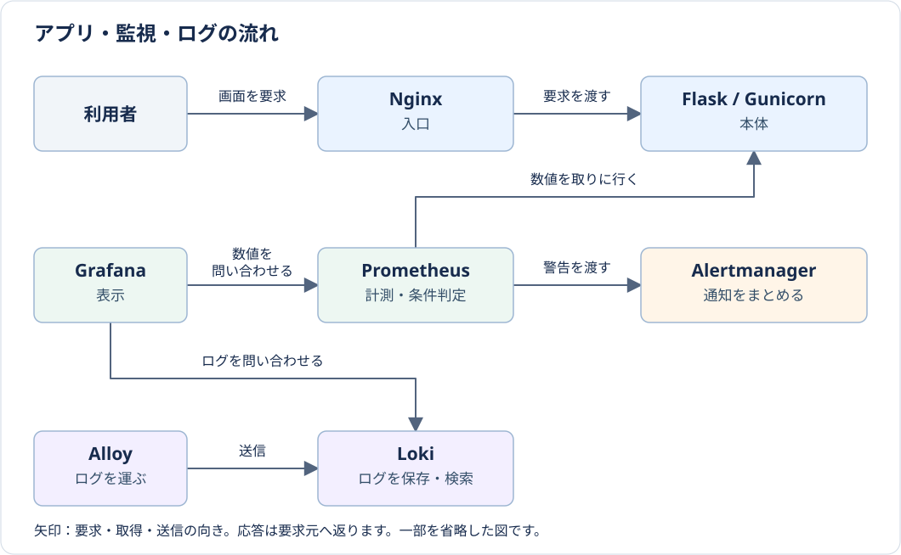

# 島田則幸 (Noriyuki Shimada)

**Linux サーバーの構築・運用を担うインフラエンジニアを志望しています。** 手順書と確認者のある基礎業務から経験を積みたいと考えています。

**現況（2026-11-05 本人確認）**：10/7 から IT 企業でトライアル就労・社内研修中。勤務開始時期は相談となります。

## 主作品：サーバー構築・監視ラボ

**[server](https://github.com/ns7jp/server)** で、Linux 上のアプリ稼働、数値・ログの監視、Windows Server / AD の構築・復旧を学んでいます。

図は実装した構成です。確認済みの範囲は演習ごとに異なり、全構成の一連の検証は未完了です。[設計判断](./docs/adr/README.md)

<!-- markdownlint-disable-next-line MD033 -->

## まず見ていただきたい 3 本

以下は、**AI の手順案内を受けて私が VM を操作・確認した個人学習**です。Linux の3事例を、[結果票と原画像](./docs/evidence/featured-evidence.md)で確認できます。

- **Ubuntu：SSH の設定不備から復旧** — 設定を復元し、`sshd -t` の終了コード 255 → 0 と鍵接続の成功を確認。[記録](https://github.com/ns7jp/server/blob/main/docs/evidence/2026-09-08-lab-base01-initial-build.md)
- **Ubuntu：停止と再開を監視で確認** — Prometheus / Grafana でアプリのメトリクス収集状態が 1 → 0 → 1 と変わることを確認。[記録](https://github.com/ns7jp/server/blob/main/docs/evidence/2026-09-08-lab-base01-monitoring-practice.md)
- **Ubuntu：アプリの自動再起動を確認** — 再起動回数 0 → 1、PID の変化、HTTP 復帰 2 秒を記録し、その後の healthy・HTTP 200 を確認。2 秒は1回の計測です。[記録](https://github.com/ns7jp/server/blob/main/docs/evidence/2026-09-08-lab-base01-d1-practice.md)

演習ごとに構成が異なり、上の結果を一つの構成の運用試験として合算しません。最近の本人操作では、11/5 に7サービスの部分構成で **監視 → ローカル通知 → 手動復旧 → 復旧通知**を確認しました。[結果と残る確認](./docs/practice-status.md)

補足の失敗・調査事例：[AD 復元後の SYSVOL 欠損（修正手順の検証未完了）](https://github.com/ns7jp/server/blob/main/docs/evidence/2026-09-02-ad-restore-drill.md)／[WSUS の承認試験（総合 FAIL・通し再試験未実施）](https://github.com/ns7jp/server/blob/main/docs/evidence/2026-09-08-wsus-sit04-sit06-root-cause.md)。

## 経験・資格

製造・物流を中心に約15年。動線と手順の改善で、1日約1時間の作業短縮につなげました。[業務改善レポート](./docs/business-improvement/picking-improvement.md)

IT パスポート、Python 3 エンジニア認定基礎・実践、PHP 8 技術者認定初級を取得。基本情報技術者を学習中です。

## 詳しく見る

| 知りたいこと | 開くページ |
| --- | --- |
| 職歴・応募条件 | [採用ご担当者さまへ](./docs/overview-for-recruiters.md)・[職務経歴書](./docs/resume.md)・[スキルシート](./docs/skill-sheet.md) |
| 原画像・確認範囲 | [代表実績と証拠](./docs/evidence/featured-evidence.md) |
| 実習の状況・学習記録 | [実習状況と次の確認](./docs/practice-status.md)・[学びと失敗の記録](./LEARNINGS.md) |
| その他の作品 | [作品案内](./docs/github-profile-cleanup.md#主作品と副作品) |

<!-- markdownlint-disable-next-line MD033 -->

## Contact

[net7jp@gmail.com](mailto:net7jp@gmail.com) ／ [GitHub](https://github.com/ns7jp)
