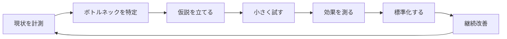

# 現場経験とインフラ運用の比較資料

[経験と志望理由の要約](./career-bridge.md) ／ [志望トラックと証跡](./target-roles.md)

採用向け本文から分けた、仕事の進め方・技術概念・設計資料の対応表です。**転用の考え方を整理した資料であり、記載した IT 業務の実務経験や独力技能の一覧ではありません。** 文書・コードには [AI の生成支援](./ai-usage.md)を利用しています。

物流改善の実数は「本人の作業時間を 1 日約 1 時間短縮」です。カテゴリ別の時間やミス件数・OJT 期間などは、原資料が残っていないため再構成した想定値、または定性評価です。[業務改善レポートの区分](./business-improvement/picking-improvement.md)に従い、チーム全体の計測値とは扱いません。

IT 側の記載には、設計のみ・未着手のテーマ、CI / AI の実行結果、AI の案内に沿った本人操作が含まれます。[検証証跡台帳](https://github.com/ns7jp/server/blob/main/docs/evidence/README.md)で実施者・環境・日付・未確認範囲を確認できます。

## 1. 共通する仕事の構造

製造・物流で経験した改善の進め方を、インフラ運用の学習に対応付けています。以下は比較のための例で、右欄の業務を本人が実務で担当したという意味ではありません。

| ステップ | 物流現場の例 | インフラ運用の例 |
| --- | --- | --- |
| 計測 | 15 分単位の作業時間ログ | SLI（可用性、レイテンシ）の継続計測 |
| 特定 | 「場所探し」が 1 日 1 時間（再構成した想定内訳） | エラーが増える時間帯 |
| 仮説 | 棚ラベル更新で短縮できる | nginx keepalive 設定で改善する |
| 試す | 1 列だけ動線変更 | staging で設定変更 |
| 測る | 1 週間の作業時間変化 | p95 レイテンシの推移 |
| 標準化 | 場所マップ + 補充閾値表 | ランブック + IaC 化 |
| 改善 | 季節要因で再見直し | 月次 SLO レビュー |

物流現場で「**継続計測ルール不在**」だった反省（[業務改善レポート](./business-improvement/picking-improvement.md)）が、サーバー監視ラボの [SLO 設計](./server-monitor-improvements/04-slo-design.md) に直接活きています。

---

## 2. スキル転用マップ

### 2.1 計測・分析

| 物流現場 | インフラ運用 | 該当ドキュメント |
| --- | --- | --- |
| 15 分単位の作業時間記録 | SLI 計測（Prometheus / Loki） | [04. SLO 設計](./server-monitor-improvements/04-slo-design.md) |
| 「忙しい時間帯」の特定 | アラートで負荷のピークを検知する | [04. SLO 設計](./server-monitor-improvements/04-slo-design.md) |
| 出庫頻度の集計 | アラート発火頻度・ノイズ率の集計 | [今後の興味リスト](./roadmap/README.md)（未着手） |
| 容量上限の把握（棚・倉庫） | キャパシティ計画（CPU / Mem / Disk / RPS） | [今後の興味リスト](./roadmap/README.md)（未着手） |

### 2.2 標準化・属人化排除

| 物流現場 | インフラ運用 | 該当ドキュメント |
| --- | --- | --- |
| 場所マップで「新人でも探せる」 | 構成図 + ランブックで「当番でも復旧できる」 | [server 構成](https://github.com/ns7jp/server/blob/main/docs/architecture.md) |
| 棚ラベル統一（表記揺れ排除） | リソースタグ規約・命名規則 | [03. Terraform 化](./server-monitor-improvements/03-terraform-aws.md) |
| 補充閾値表で「気付いた人がやる」を脱却 | アラート閾値・自動スケール | [04. SLO 設計](./server-monitor-improvements/04-slo-design.md) |

### 2.3 運用カイゼン

| 物流現場 | インフラ運用 | 該当ドキュメント |
| --- | --- | --- |
| 動線改善（ABC で棚再配置） | アラート最適化（ノイズ削減） | [今後の興味リスト](./roadmap/README.md)（未着手） |
| 季節要因で計測期間を見直す | 月次のふりかえり、指標の確認 | [04. SLO 設計](./server-monitor-improvements/04-slo-design.md) |
| 「カイゼンのリバウンド防止」 | IaC + CI で「設定が手動で戻らない」 | [02. Ansible](./server-monitor-improvements/02-ansible-automation.md) |
| 棚卸し（実物と帳簿の突合） | 構成棚卸し（Ansible / AWS Config） | [02. Ansible](./server-monitor-improvements/02-ansible-automation.md) |
| 「変えてはいけない時期」を決めておく | 変更を控える期間（年末年始・連休前） | [11. 変更管理](./server-monitor-improvements/11-change-management.md) |
| 想定外への備え（停電演習） | 意図的に障害を起こして復旧を練習する（カオスエンジニアリング） | [今後の興味リスト](./roadmap/README.md)（未着手） |

### 2.4 セキュリティ・統制（5S → セキュリティ統制）

| 物流現場の 5S | インフラ運用 | 該当ドキュメント |
| --- | --- | --- |
| 整理（要らない物を捨てる） | 不要 IAM ロール・古いシークレット削除 | [今後の興味リスト](./roadmap/README.md)（未着手） |
| 整頓（定位置管理） | リソースタグ規約・Namespace 分離 | [03. Terraform 化](./server-monitor-improvements/03-terraform-aws.md) |
| 清掃（日々の点検） | 監査ログ日次チェック | [今後の興味リスト](./roadmap/README.md)（未着手） |
| 清潔（清掃の標準化） | 自動化された脆弱性スキャン CI | [職務経歴書「テクニカルスキル」（Trivy / pip-audit 実装済み）](./resume.md)（実装済み） |
| 躾（ルールの定着） | セルフチェックと CI による自動チェック | 各設計書の CI セクション |

### 2.5 災害対応・BCP

| 物流現場 | インフラ運用 | 該当ドキュメント |
| --- | --- | --- |
| 機械停止時の手作業フォロー | プロセス障害時のフェイルオーバー | [server ランブック](https://github.com/ns7jp/server/blob/main/docs/runbooks/service-down.md) |
| 繁忙期のピーク対応 | 負荷スパイク時のオートスケール / 帯域制御 | [今後の興味リスト](./roadmap/README.md)（未着手） |
| 棚卸しズレ発生時の原因追跡 | データ不整合時の調査・復旧 | [05. 復旧演習](./server-monitor-improvements/05-backup-recovery-drill.md) |
| 災害時の代替動線 | 2 AZ 冗長化、リージョン障害対応 | [03. Terraform 化](./server-monitor-improvements/03-terraform-aws.md) [05. 復旧演習](./server-monitor-improvements/05-backup-recovery-drill.md) |

### 2.6 監視ツールの転用可能性（Prometheus → Zabbix / JP1）

本ラボは Prometheus / Grafana / Loki（OSS・SRE 系）で構成していますが、国内の監視運用・運用保守の現場では **Zabbix や JP1 系** が使われることも多いと理解しています。ツールは違っても監視の基本概念は対応するため、次の対応で読み替えて習得します。

| 監視の概念 | 本ラボ（Prometheus 系） | Zabbix | JP1 系 |
| --- | --- | --- | --- |
| メトリクス収集 | exporter（pull） | Zabbix エージェント / アイテム | JP1/PFM のレコード収集 |
| 監視対象の登録 | scrape config / service discovery | ホスト登録 + テンプレート | エージェント管理 |
| 異常判定のルール | alerting rule（PromQL） | トリガー（条件式） | 監視条件・しきい値定義 |
| 通知・エスカレーション | Alertmanager（ルーティング・抑制） | アクション（段階通知） | JP1/IM の自動アクション |
| 可視化 | Grafana ダッシュボード | Zabbix ダッシュボード / グラフ | 統合コンソール |
| ログ監視 | Loki + Alloy | ログ監視アイテム | JP1/Base ログトラップ |

「しきい値を決めて・検知して・通知して・手順書で対応する」という流れを比較する学習資料です。対応表があることを、Zabbix / JP1 を操作・習得済みという意味には扱いません。

Zabbix 側については、上記の対応表を実機で検証する演習設計を[09 Zabbix 監視基盤構築演習設計](https://github.com/ns7jp/learning/blob/main/docs/learning-plan/09-zabbix-monitoring-exercise-design.md)にまとめています（設計のみ・未実施）。JP1 系は自宅ラボでの再現が難しいため、対応表による概念の橋渡しに留めています。

### 2.7 クラウド基盤の転用可能性（AWS → Azure）

本ラボの主要クラウド／IaC 系統は AWS + Terraform（[ADR-0005](./adr/0005-terraform-for-iac.md)、[03 AWS + Terraform](./server-monitor-improvements/03-terraform-aws.md)）です（コードは `validate` / `fmt` まで。実 AWS 環境への `apply` は未実施）。国内 SIer・大手企業の社内基盤では Microsoft 365 / Entra ID との親和性から Azure の採用例も多いと理解しています。クラウドが違っても、アカウント境界・ネットワーク・IAM・IaC・監視・バックアップという設計の骨格は対応するため、次の対応で読み替えて習得します。

| インフラの概念 | 本ラボ（AWS 系） | Azure |
| --- | --- | --- |
| 課金の入れ物 | アカウント | サブスクリプション |
| リソースのグルーピング | タグ + アカウント分割 | リソースグループ |
| 仮想ネットワーク | VPC | VNet |
| ファイアウォール | セキュリティグループ（インスタンス単位） | NSG（サブネット/NIC 単位） |
| 管理アクセス | Session Manager / 踏み台ホスト | Azure Bastion |
| IAM | IAM ユーザー / ロール / ポリシー | Entra ID + RBAC |
| IaC ツール | Terraform（`aws` provider） | Terraform（`azurerm` provider） |
| 監視 | CloudWatch | Azure Monitor + Log Analytics |
| バックアップ | EBS スナップショット / AWS Backup | Azure Backup（Recovery Services vault） |

「アカウント境界を切り、ネットワークと IAM を設計し、同じ IaC ツールでコード化し、監視とバックアップを組み込む」という骨格は共通です。違うのはクラウドごとの provider・リソースモデル（Azure はテナント → サブスクリプション → リソースグループという入れ子構造を持つ）であり、**IaC ツール（Terraform）を固定したまま対象クラウドだけ増やせる**ことを、面接で「うちは Azure だが」と問われた際の説明材料にしています。

Azure 側については、上記の対応表を実機で検証する演習設計を[10 Azure構築演習設計](https://github.com/ns7jp/learning/blob/main/docs/learning-plan/10-azure-foundational-exercise-design.md)にまとめています（設計のみ・未実施）。

### 2.8 現物スキルの転用（物流現場 → データセンター現地作業・デスクワーク適応）

ここでは、物流現場の経験とデータセンター現地作業の接点を整理します。右欄は今後学ぶ作業であり、機材固有の手順・安全上の注意は別途習得が必要です。

| 物流現場 | データセンター現地作業 |
| --- | --- |
| フォークリフト・台車での重量物運搬 | サーバー・ラック機材の搬入、ラックマウント |
| ハンディ端末でのバーコード資産管理・棚卸し | 資産管理台帳（ラベル / バーコード）によるハードウェア棚卸し |
| 結線・梱包の整理（誤配送防止） | ケーブルマネジメント、ラベリング規則 |
| 入出庫時のダブルチェック | 入退室管理、作業記録（メンテナンス作業のログ） |

また、現場作業からの転職では「長時間の PC 作業・タイピング・複数モニターでのオペレーション・チケット管理ツールの操作」といったデスクワークへの適応も見られやすいポイントです。学習・ポートフォリオ制作自体が日々の Linux ターミナル操作と Markdown でのドキュメント作成を伴うため、机上作業への適応はこの制作プロセスを通じて進めています。

**この節はまだ概念の橋渡し段階で、データセンター現地作業そのものの実務・実習経験はありません。** 実際の現地作業（ラックマウント演習等）を行った場合は、[LEARNINGS.md](../LEARNINGS.md)と証跡台帳に記録します。

---

## 3. 一段深い共通点 — 「**現場と本社の翻訳者**」

物流現場では「現場の困りごと」と「本社の改善方針」をつなぐ立場でした。
この経験を、インフラ運用で状況や作業結果を分かりやすく報告する場面に活かしたいと考えています。

| 物流での経験 | インフラ運用での活かし方 |
| --- | --- |
| 現場の言葉で課題を整理し、上長に「数値で」報告 | 障害の影響を分かりやすく整理して共有する |
| 本社施策を現場が動けるレベルに咀嚼 | 決めた方針を日々の運用ルールに落とし込む |
| 現場の負荷感覚をデータ化する習慣 | アラートが多すぎないか確認し、負担を減らす工夫をする |

---

## 4. 「失敗からの学び」を仕組み化する習慣

物流現場の業務改善で **最大の反省点** だったのは、改善後の継続計測を仕組み化しなかったことです（[業務改善レポート §6](./business-improvement/picking-improvement.md)）。

この経験を学習につなげるため、以下の設計・コード・今後のテーマに対応付けています。各項目の実装・検証範囲はリンク先と[実装対応表](./server-monitor-improvements/README.md)で区別します。

| 学んだこと | 監視ラボでの反映先 |
| --- | --- |
| 単発の改善でなく **継続計測ルールを最初に設計** する | [04. SLO / SLI / エラーバジェット設計](./server-monitor-improvements/04-slo-design.md) |
| 気づいたことを **記憶だけでなく記録に残す** | [今後の興味リスト](./roadmap/README.md) |
| 「次回は気を付ける」で終わらせない、**仕組みで防ぐ** | [今後の興味リスト](./roadmap/README.md) |
| 自分しか知らない手順を作らない | [02. Ansible で手順をコード化](./server-monitor-improvements/02-ansible-automation.md) |

> **過去の反省を、次の現場では仕組みで防ぐ** — これが現場経験 15 年から得た最大の学びです。

---

## 5. 期待される役割と提供できる価値

| 関心のある業務 | 経験・学習との接点 | 参照先 |
| --- | --- | --- |
| サーバー監視・運用 | 構築 → 監視 → 障害対応を学ぶ設計・実装（AI 支援あり） | [server](https://github.com/ns7jp/server) |
| 業務改善提案 | 数値で語る改善、上長合意の取り方 | [業務改善レポート](./business-improvement/picking-improvement.md) |
| ドキュメント運用 | AI の文書生成支援を受けた手順書・設計書の整理 | 本リポジトリ全体 |

## 関連資料

[実装対応表](./server-monitor-improvements/README.md) ／ [ADR](./adr/README.md) ／ [構成図](./architecture-diagram.md) ／ [資格取得計画](./certifications/roadmap.md)
